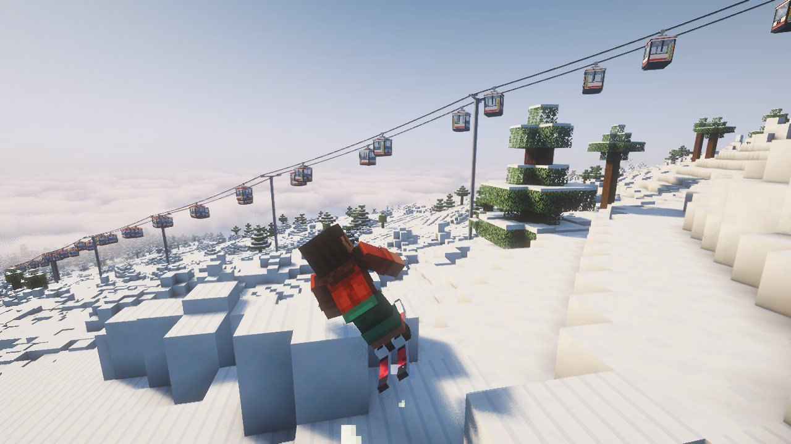
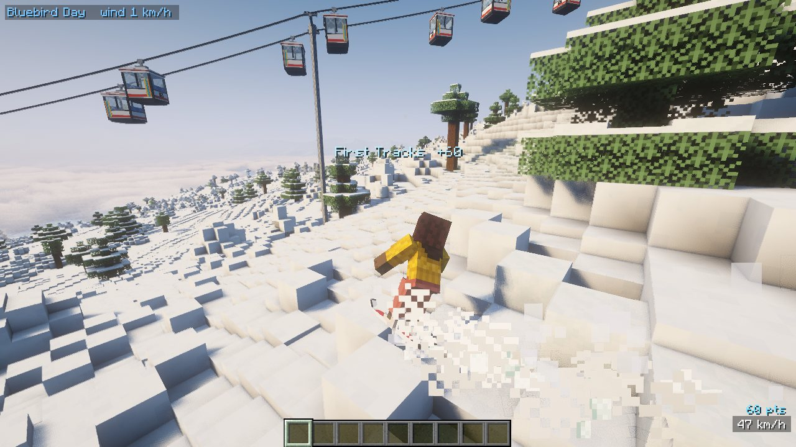
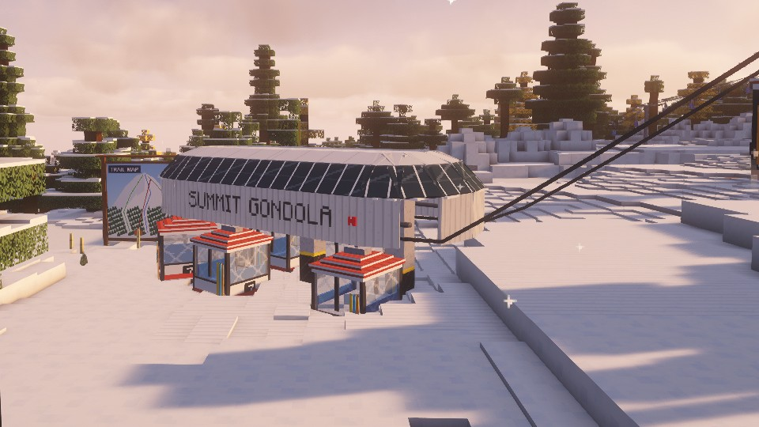
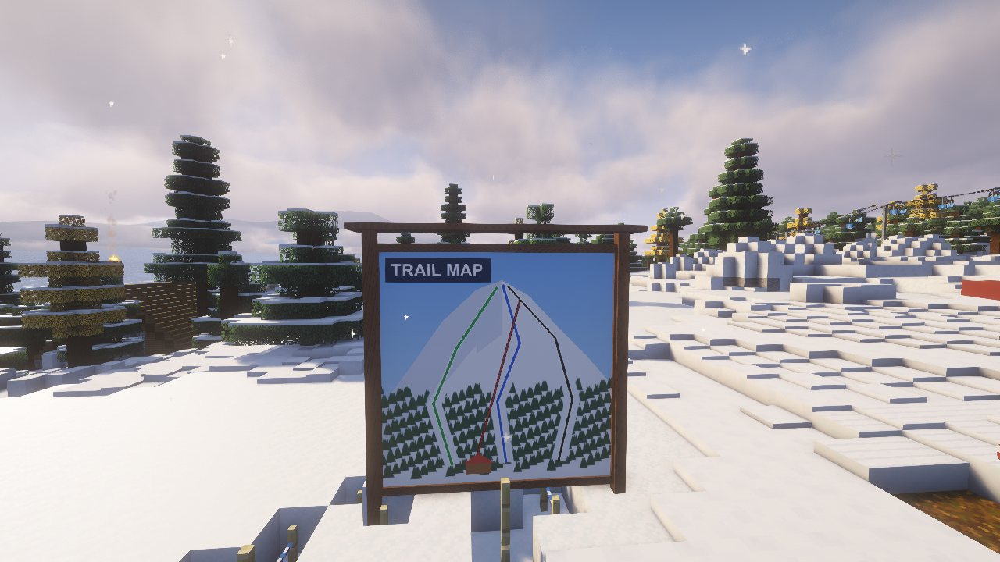
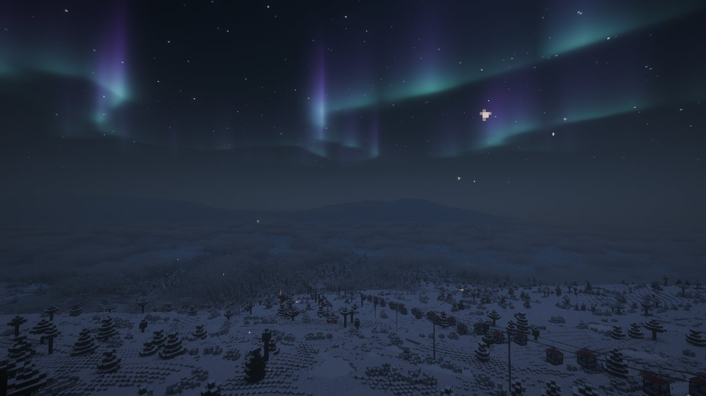
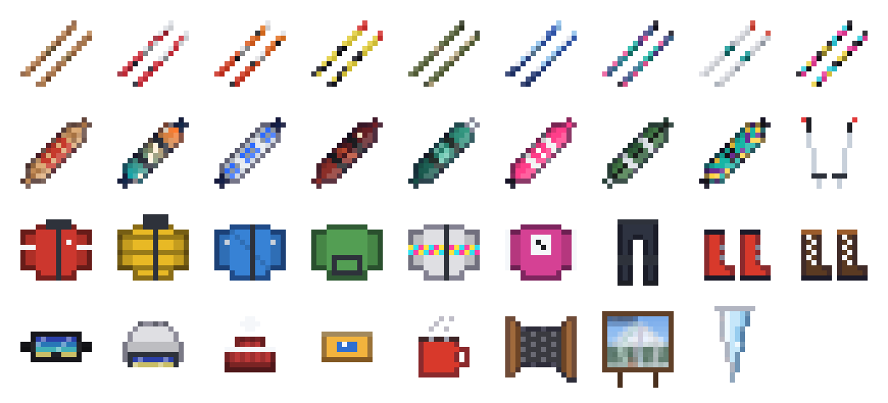
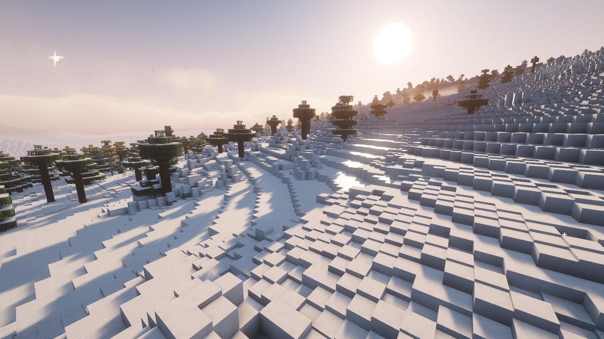

<div align="center">

# ⛷️ Fresh Tracks

**Skis, snowboards and real chairlifts for Minecraft Java 26.3**

Carve on your edges, drop into powder, ride the gondola to the top, and live on the mountain.

[**⬇ Download**](../../releases/latest) &nbsp;·&nbsp; [**Website**](https://griffdog21.github.io/FreshTracks/) &nbsp;·&nbsp; [**How to install**](#-install-in-2-minutes) &nbsp;·&nbsp; [**Controls**](#-controls)



</div>

## Like the mod? Join the server

Come ski Snowmass with us: shared laps, park sessions, powder days, and Base Village and the Mall lit up after dark, with real restaurants serving what they're known for.

1. **Install the pack:** get [Prism Launcher](https://prismlauncher.org) or the [Modrinth App](https://modrinth.com/app), then import **`FreshTracks-1.5.0.mrpack`** from the [releases page](../../releases/latest) ([step by step](#-install-in-2-minutes)).
2. **Wake the server:** open **[griffdog21.github.io/FreshTracks/play](https://griffdog21.github.io/FreshTracks/play/)**, press *Wake the server* and wait for **Online** (about two minutes). It sleeps 15 minutes after the last skier leaves.
3. **Join:** in the Fresh Tracks instance, **Multiplayer → Add Server → `18.227.232.192`**.
4. **Register (first visit):** type `/register` for free skis, a snowboard, gear and a packed lunch. Your Minecraft account is your login; no password.

Keep **Simple Voice Chat** ticked in the pack to talk to skiers near you. Can't connect? The server is still waking up. "Incompatible client"? Re-import the latest `.mrpack`. [Full guide and troubleshooting →](https://griffdog21.github.io/FreshTracks/server.html#join)

## New in 1.5.0: Ski School and leaderboards

- **Ski School:** seven short lessons for your first day on the mountain: click in, ride a lift, ski some vertical, hit 50 km/h, land a trick, try a butter and buy something. Each pays Ski Bucks, and graduating earns 200 more and the Ski School Graduate Pin. New skiers get a nudge toward the next lesson when they join.
- **Leaderboards:** `/leaderboard` ranks everyone who's ever skied the server: most Ski Bucks earned, most days, best streak, most vertical, biggest trick (with its name), longest air and top speed. `/leaderboard trick` (or `earned`, `air`...) shows the top ten.
- **The leaderboard board:** on the Snowmass server, a timber board on the Base Village plaza, right where new skiers arrive, shows the champions live.

### Included from 1.4.0: Ski Bucks you can chase for weeks

- **Earn for everything:** tricks as before, plus every bit of vertical you ski, the first chair of the day, and a bonus for each day on the mountain (bigger on a streak).
- **Daily challenges:** three a day, the same for everyone on the server ("Ski 1,500 blocks of vertical", "Land a 2,000-point trick"...), each with a bounty and a bonus for sweeping all three. Type `/skibucks` to see them, your wallet and your pass.
- **Passes that take weeks:** Day Ticket, Local, Season Pass, Ski Bum, Legend and Founders' Circle. Each needs days on the mountain (a day counts once you ride 10 minutes) and lifetime earnings. The best shop gear stays locked until you get there.
- **Pro shop:** ski and board techs now sell branded, tuned gear for Ski Bucks: skis and boards that ride a few percent better, jackets with extra warmth, up to numbered limited editions like The Golden Skis (ten per world).
- **Real money:** Ski Bucks come as 1s, $100 and $1,000 bills. Shops make change automatically; use a bill to break it, sneak-use to tidy your wallet.
- **Ski Bucks take a real grind:** big tricks still pay more, but with diminishing returns (at most 40 Ski Bucks a trick), and after 800 Ski Bucks from tricks in a day the rest pay a quarter. Skiing vertical, daily challenges, streaks and first chair pay in full, so the best way to earn is to ski the mountain every day.
- **Shaders included:** the mod pack now brings the Complementary Unbound shader pack, switched on with Iris (press **K** in game to turn shaders off on slower computers).
- **Voice chat and smoother play:** the mod pack now offers Simple Voice Chat (talk to skiers near you on the Snowmass server), Lithium and FerriteCore. All optional; untick any in your launcher.
- **Wallet on screen:** while you ride, your Ski Bucks total sits above the speedometer and every payout flashes in.
- **Golden Tickets:** very rare finds from big tricks, streaks and daily sweeps, wanted by the best shops.

### Included from 1.3.0

- **Real pole pushes:** hold W with poles in hand for rhythmic double-pole plants, each a real shove (about 30 km/h on the flats). Without poles you skate; on a board you push with one foot.
- **Realistic ollies:** a tap is a knee-high hop, a full charge about three-quarters of a block. Big air comes from your speed off kickers and rollers, so you land on rails and boxes instead of sailing over them.
- **Wind-up spins:** hold A or D while charging an ollie to take off already spinning.
- **Perfect pop:** release jump right at a kicker lip or the crest of a roller for extra height.
- **Stomp boost:** stomped trick landings ride away with a burst of speed.
- **Snowboard butters:** presses and rolls score as real board tricks (Nose Press, Tail Press, Nose/Tail Roll 180, 360...), the board pivots faster on its nose or tail, and jumping out of a press pops a bigger nollie or ollie that chains into your combo.
- **Sky Cab ("the Skittles")** now runs four groups of three cabins, each group one colour (red, blue, green, yellow) with a black band, like the real lift.

#### Included from 1.2.9

- **Keep your crash gear:** skis and snowboards dropped by a wipeout or full inventory can only be picked up by their rider, including after a world reload.
- **Protect earned Ski Bucks:** rewards that do not fit in your inventory wait for you as owner-only drops. Hoppers and hopper minecarts cannot collect protected gear or currency.
- Shop payments still use the existing merchant trades and displayed prices. Ski Bucks remain ordinary spendable items; deliberately dropping an item still lets you give it to a friend.
- Trick rewards require an active ski or snowboard ride; non-positive and invalid air-time claims are ignored.

### Included from 1.2.8

- **Working rails and boxes:** ride or land on a Park Rail, Park Box or Classic Red Park Box to engage a grind. The deck guides your travel while A/D rotates your skis or board into a slide. Sideways deck landings preserve momentum; Space loads and releases a pop off the feature.
- **Ski and snowboard butters:** on skis or a snowboard while moving on snow, hold left click + W for a nose press or left click + S for a tail press. Add A/D to spin a butter; release left click to straighten into regular or switch riding. Left click alone defaults to a tail press. The same press controls work during rail/box slides. On a snowboard the board pivots faster and scores real board tricks (Nose Press, Tail Press, Nose Roll 180/360, Tail Roll 180/360), and jumping out of a press pops a bigger nollie or ollie that chains into your combo.
- Slides and butters earn trick points, combo credit and Ski Bucks through the existing scoring system. Standing still does not earn trick points.
- Visible grind/butter HUD states, a sliding sound, crouched stance and board press poses. The trick button no longer breaks blocks while riding.
- Narrow rails use their actual width and no longer create invisible snow ramps beside them.

### Included from 1.2.7

- **Helmet camera:** press **V** on skis or a snowboard to switch between first-person and chase views. Your riding view is remembered; stepping out restores your usual view. Full-motion helmet view follows airborne spins and flips, including upside-down rotation; Reduced motion and Off keep the steadier view.
- **Feel your speed:** smooth speed FOV, gentle banking, a lower tuck stance and more progressive wind rush. Press **J** or use **`/ftride`** for camera, reduced-motion and wind settings.
- **Smoother turns:** A/D carves wider at speed instead of forcing a skid. Edge changes and pushing off are quicker; S and Shift still scrub speed deliberately.
- The ride HUD shows tucking, carving, skidding and braking, with an edge indicator. Speed readings and the top-speed limit are unchanged.

### Snow through the day

Clean linked carves preserve more momentum and give a small downhill pressure release. Powder planes sooner and keeps more speed through turns; powder gear floats earlier. Braking, skidding and uphill travel still lose speed.

Groomed Snow is refreshed once each Minecraft morning. Traffic progresses through tracked, chopped and skied-off appearances and grip, without digging holes into groomers. Unloaded sections catch up when visited; reloading a chunk or restarting the server does not reset that day's tracks. Existing Groomed Snow works in any world; a private map can designate additional groomed runs. Set `autoGroomRuns` or `slopeWear` to `false` in `config/freshtracks.json` to disable either feature.

Newly generated **Ski Mountains** terrain includes seeded progression parks with tabletop jumps, a halfpipe, boxes and rails. Glade pillow lines follow the downhill slope with broader rounded snow caps and varied buried rocks. Existing explored terrain is preserved.

Park Rail, Park Box and an optional Classic Red Park Box are available in the Fresh Tracks creative tab. Their slippery riding surface preserves momentum without rock damage to equipment.

### Included from 1.2.6

- Fixed lift animation racing around the cable during wind holds or stops.
- Small backward position corrections now stay small, including at the cable loop boundary.

### Included from 1.2.5

- Mid-station carrier rails stay level and give gondola cabins clearance above the platform.
- Mid-station sheaves line up with the corrected cable height, with mast sleeves connecting them to their supports.

### Included from 1.2.4

- Fixed the missing Ski Bucks icon in inventory and shop trades. Ski Bucks now display using the intended gold token model.

### Included from 1.2.3

- Pulse gondolas use exposed bullwheel terminals and groups of three cabins.
- Gondola housings fit the shared cable envelope without the enlarged roof scale.
- Lift data supports a configurable bottom loading angle, including 90-degree loading.
- Existing ski currency, gear shops, shader support and Distant Horizons support remain included.

Use the same Fresh Tracks version for everyone in a multiplayer world.
## ✨ What's in it

| | |
|---|---|
|  | **Skiing that feels like skiing.** Lean onto an edge with A/D and carve; dig in with S to scrub speed; tuck with W. Powder floats you once you're moving and leaves real tracks. Link turns through untouched snow for **First Tracks** combos. Ollie off rollers, throw spins, flips and grabs, and stomp the landing (or yard-sale). |
|  | **Lifts that actually run.** Doubles, quads, six-pack expresses that slow down in the stations, gondolas with glass cabins, T-bars and platters that tow you up on your skis, and magic carpets. Build one with two terminals and a cable; towers place themselves. Express lifts and gondolas get real detachable stations: a long housing up on columns with a dark glass roof band and the lift's name down the side. Stand on **LOAD HERE**, sit down, ride to the top. |
|  | **Build your own resort.** Trail signs with run names and difficulty, trail markers, rope-line mazes, orange closure fencing, SLOW ZONE, EXPERTS ONLY and SKI AREA BOUNDARY signs, hazard poles, padded towers, trail map boards, snow guns that make snow overnight, groomed corduroy, snowy service roads you can ski across, timed race courses. |
|  | **Mountain weather.** Every morning rolls a new day: bluebird, powder day, snowstorm, blizzard, thundersnow, high wind, cold snap, flat light, spring slush. Fresh snow piles up in storms, wind holds the lifts, cold snaps freeze the unprepared, and on clear cold nights the northern lights come out. |

### 🎿 Gear



Nine pairs of skis and eight snowboards (wooden skis to race skis, snurfer to splitboard), each riding differently. Goggles that see through blizzards, helmets, beanies, six dyeable jackets, snow pants, ski and snowboard boots, poles, wax and hot cocoa. Tricks pay out Ski Bucks; Snowmass village shops take them for food, lift tickets, and gear. Ski Techs, Board Techs, Lifties and Ski Patrol work in the villages.

### 🏔️ Mountains

A **Ski Mountains** world type with huge ranges, long cruisers and steep bowls up top, plus six new alpine biomes in normal worlds: Powder Bowls, Frosted Glades, Larch Basin, Aspen Hollow, Alpenglow Peaks and Glacier. Ski lodges, ski shops and board shops turn up in the snowy villages.

### 🗺️ Test world

Want to jump straight in? The **Fresh Tracks Test World** is a ready-made ski hill: a gondola to the summit, an express quad, a T-bar and a beginner chair, a lodge and shops at the base, a groomed main run with snow guns, a terrain park, signs and a trail map. It's on the [download page](../../releases/latest).



## 📦 Install in 2 minutes

Everything comes as one file you import into a launcher. It makes its own separate game folder, so **your normal Minecraft worlds are never touched**.

**Prism Launcher** (recommended, free: [prismlauncher.org](https://prismlauncher.org))
1. Download **`FreshTracks-1.5.0.mrpack`** from the [releases page](../../releases/latest).
2. In Prism: **Add Instance → Import** → pick the file → **OK**.
3. Select the new **Fresh Tracks** instance and press **Launch**.

**Modrinth App** ([modrinth.com/app](https://modrinth.com/app))
1. Download **`FreshTracks-1.5.0.mrpack`**.
2. **+ (Create instance) → Import from file** → pick it → **Play**.

The pack sets up Minecraft 26.3, Fabric and Fresh Tracks for you, and offers **Sodium, Iris (shaders) and Distant Horizons** as optional extras (untick them if your PC struggles). For the screenshots above: Iris with the *Complementary Unbound* shader pack.

**Test world:** unzip `FreshTracks-1.2.1-TestWorld.zip` into the instance's `saves` folder (Prism: **Folder → saves**) and pick it in Singleplayer.

<details>
<summary>Manual install (official launcher)</summary>

1. Install Fabric for Minecraft 26.3 with the [Fabric installer](https://fabricmc.net/use/installer) (give the profile its own game directory so your normal worlds stay separate).
2. Put `freshtracks-1.5.0.jar` and [Fabric API](https://modrinth.com/mod/fabric-api) (0.162.0+26.3) in that game directory's `mods` folder.
</details>

## 🎮 Controls

| Key | On skis / board | In the air |
|---|---|---|
| **Right-click** with skis or a board | Click in | |
| **W** | Push / skate, tuck when fast | Front flip *(after a jump)* |
| **S** | Snowplough / heel-edge slide | Back flip *(after a jump)* |
| **A / D** | Lean onto an edge and carve | Steer the landing, spin *(after a jump)* |
| **S + A or D** | Edge check: swing across the hill and dig in to slow down or stop | |
| **Space** | Hold to crouch, release to ollie | Tap to throw a trick off a ledge |
| **Left click** | Hold on moving skis or a board to butter; +W nose press, +S tail press, +A/D spin | Grab |
| **Shift** | Hockey stop (step out when stopped) | |
| **V** | Switch helmet / chase view (remembered) | Same |
| **J** | Riding settings: camera, speed effects, wind volume | Same |

Rebind V/J under **Options → Controls → Key Binds → Fresh Tracks riding**. `/ftride` opens riding settings; `/ftcamera helmet`, `/ftcamera chase` and `/ftcamera keep` choose your preferred view. Reduced motion keeps the horizon level and uses a smaller FOV change; Off disables riding camera motion/FOV effects. Minecraft's FOV Effects slider is also respected.

**Parks:** approach along the length of a Park Rail or Park Box. Contact engages automatically. A/D rotates your stance; hold and release Space to pop off. No separate grind button is needed. Jump, spin, flip and grab controls still work in the air.

Lifts: stand on **LOAD HERE**, the screen counts down to your chair. Hold Shift for a second to jump off. On a T-bar, Shift lets go.

## 🖥️ Play with friends

- **Open to LAN** works as usual. Everyone needs the same Fresh Tracks version.

## 🛠️ Build from source

Needs JDK 25. Assets (models, textures, sounds, data) are generated by the Python scripts in `tools/` (run with [uv](https://docs.astral.sh/uv/)).

```bash
./gradlew build                      # build/libs/freshtracks-<version>.jar
uv run python tools/gen_assets.py    # regenerate the JSON assets and data
uv run python tools/package.py       # dist/: .mrpack and client mod jar
```

## 📜 License

Copyright © 2026 Griffdog21. All rights reserved: the code, textures, models and sounds were made for Fresh Tracks. Play it and run servers with it as much as you like; please link people here rather than re-uploading it elsewhere. Minecraft is a trademark of Mojang; Fresh Tracks isn't affiliated with Mojang or Microsoft.
